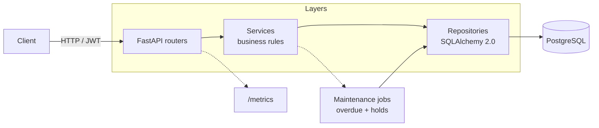

# Library Manager API

[](https://github.com/tmko33/library-manager/actions/workflows/ci.yml)
[](https://www.python.org/)
[](https://fastapi.tiangolo.com/)
[](#development)
[](LICENSE)

A production-style REST API for managing a network of public libraries: catalogue,
physical copies, members, loans, reservations and fines.

Built with **FastAPI**, **SQLAlchemy 2.0 (async)**, **PostgreSQL** and **Alembic**.

## Architecture



```text
app/
├── api/v1/routers/   HTTP layer (request parsing, authorization)
├── core/             configuration, security, errors, pagination
├── db/               engine, session, declarative base
├── models/           SQLAlchemy 2.0 ORM models
├── schemas/          Pydantic v2 request/response models
├── repositories/     data access
├── services/         business rules and transactions
└── main.py           application factory
```

Request flow: `router → service → repository → database`. Routers never touch the
session directly and repositories never contain business rules.

## Quick start

### With Docker

```bash
cp .env.example .env
docker compose up --build
```

The API is available at <http://localhost:8000>, docs at <http://localhost:8000/docs>.

### Local development

Requirements: Python 3.12 and Docker.

```bash
python -m venv .venv
source .venv/bin/activate          # Windows: .venv\Scripts\activate
pip install -e ".[dev]"

cp .env.example .env
docker compose up -d db
alembic upgrade head
uvicorn app.main:app --reload
```

### Seed demo data

```bash
python -m scripts.seed
```

This creates an admin, a librarian, a member and a small catalogue. On platforms
without shell access, set `SEED_DEMO_DATA=true`, redeploy once, then remove it.

| Account | Email | Password |
|---|---|---|
| Admin | `admin@library.dev` | `library12345` |
| Librarian | `librarian@library.dev` | `library12345` |
| Member | `member@library.dev` | `library12345` |

## Authentication

```bash
TOKEN=$(curl -s -X POST http://localhost:8000/api/v1/auth/login \
  -d "username=admin@library.dev&password=library12345" | jq -r .access_token)

curl -H "Authorization: Bearer $TOKEN" http://localhost:8000/api/v1/loans
```

## Main endpoints

| Method | Path | Description |
|---|---|---|
| `POST` | `/api/v1/auth/register` | Public sign-up |
| `POST` | `/api/v1/auth/login` | Obtain a JWT |
| `GET` | `/api/v1/books` | Search catalogue (`q`, `author_id`, `available`, …) |
| `POST` | `/api/v1/books` | Create a book (staff) |
| `POST` | `/api/v1/books/{id}/copies` | Register a physical copy (staff) |
| `GET` | `/api/v1/loans` | List loans (scoped by role) |
| `POST` | `/api/v1/loans` | Borrow a book |
| `POST` | `/api/v1/loans/{id}/return` | Return a loan |
| `POST` | `/api/v1/loans/{id}/renew` | Renew a loan |
| `POST` | `/api/v1/reservations` | Join the waiting queue |
| `GET` | `/api/v1/fines` | List fines (staff) |

## Business rules

- A member can hold at most `MAX_ACTIVE_LOANS` simultaneous loans.
- Members with overdue loans or unpaid fines cannot borrow.
- Only `MAX_RENEWALS` renewals are allowed, and never while a reservation is queued.
- Waiting lists are FIFO: the first reservation holder has priority.
- Holds expire after `RESERVATION_HOLD_DAYS` and are released.
- Late returns generate a fine of `FINE_PER_DAY` per day overdue.

## Operations

| Endpoint | Purpose |
|---|---|
| `GET /health` | Liveness probe |
| `GET /health/ready` | Readiness probe (checks the database) |
| `GET /metrics` | Prometheus metrics |

Every response carries an `X-Request-ID` header (generated or propagated from
the request). Access logs include the request id so a single request can be
traced across services.

Scheduled maintenance runs overdue detection and hold expiration:

```bash
python -m scripts.maintenance
```

Schedule it with cron, a Kubernetes CronJob or your platform's scheduler.

## Features

- Full CRUD for books, authors, publishers, branches and copies.
- Physical copy tracking with inventory codes and lifecycle states.
- Lending workflow: borrow, return, renew, overdue detection.
- Reservation queue with FIFO priority and hold windows.
- Automatic fine calculation for late returns.
- JWT authentication with `admin`, `librarian` and `member` roles.
- Pagination, filtering and sorting on every collection.
- Consistent RFC 7807 (`problem+json`) error responses.
- Request correlation, Prometheus metrics and readiness probes.

## Deployment

See [docs/deployment.md](docs/deployment.md) for Render and Docker instructions.
The repository ships a `render.yaml` blueprint that provisions the API and a
PostgreSQL database, running migrations on every deploy.

## Documentation

- [API walkthrough](docs/api-examples.md) — curl examples for every workflow.
- [Deployment guide](docs/deployment.md) — Render, Docker and scheduled jobs.
- [Architecture decisions](docs/adr/) — layering, async SQLAlchemy, reservations
  and authorization.

## Development

```bash
ruff check app tests
ruff format app tests
mypy app
pytest
```

## License

MIT
